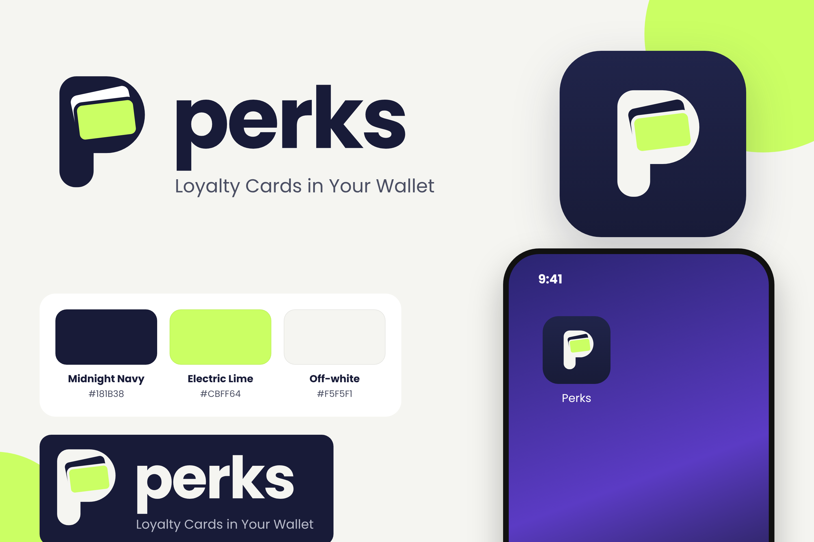

# Perks — هوية المنصة

اتعتمدت في 2026-11-10. **Perks** هو اسم المنتج اللي بيظهر للمحلات والعملاء. "Nuqta" فضل اسم داخلي للكود بس: أسماء الحزم (`@nuqta/*`) وقواعد البيانات (`nuqta_*`) والـcookies (`nq_*`) ومتغيرات البيئة (`NUQTA_*`). الأسماء دي متغيرتش عمدًا، عشان تغييرها كان هيكسر الباك أب والنشر والجلسات الموجودة.

## الألوان

| الاسم | الكود | الاستخدام |
|---|---|---|
| Midnight Navy | `#181B38` | النصوص والأزرار الأساسية والقوائم النشطة والأيقونة |
| Electric Lime | `#CBFF64` | لمسات بس: الأيقونات النشطة، وخط التبويب، والتحديد، ورمز الكارت في اللوجو. **مايتكتبش عليه نص أبيض، ومايتستخدمش كلون نص على خلفية فاتحة.** |
| Off-white | `#F5F5F1` | خلفية المنصة |

الـtokens في `apps/web/src/design.css` (`--ink` و`--brand` و`--lime` و`--paper`)، والمصدر الواحد للرمز والأيقونات في `packages/domain/src/brand.ts`. **كروت المحلات مش بتاخد ألوان Perks**، كل كارت بهوية محله. Perks بيظهر على الكارت كتوقيع صغير بس ("PERKS ●").

## الملفات (`apps/web/public/brand/`)

| الملف | الاستخدام |
|---|---|
| `perks-logo.svg` | اللوجو الكامل بالجملة "Loyalty Cards in Your Wallet" |
| `perks-logo-wordmark.svg` | الرمز والكلمة، ومستخدم في هيدر التطبيق |
| `perks-logo-dark.svg` | نسخة فاتحة على خلفية كحلي |
| `perks-mark.svg` | الرمز لوحده |
| `perks-app-icon.svg` | أيقونة التطبيق 1024. أيقونات الـPWA والـfavicon بتتولد منها وقت الـbuild |

الكلمة مكتوبة بخط Poppins Bold (رخصة OFL) ومتحوّلة لأشكال (paths)، فمش محتاجة الخط يكون متسطب.

## قبل الإطلاق

اعمل بحث علامات تجارية للاسم في مصر، وشوف الدومين ومعرّفات السوشيال المتاحة.
