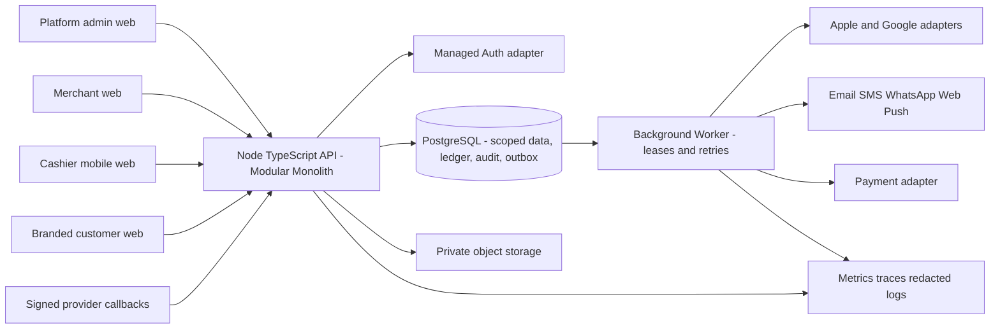
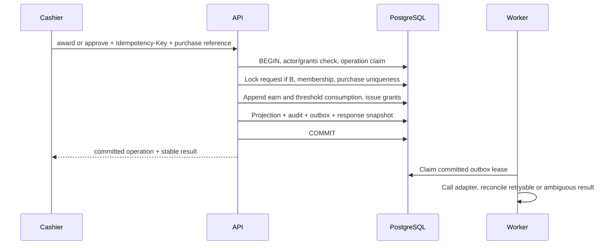

# Architecture

> تحديث التنفيذ: وصف P00 والـMock في هذا الملف يوثق الأصول عند مراجعتها. السورس الحالي المتصل وحدود قبوله في [IMPLEMENTATION](IMPLEMENTATION.md) و[STATUS](STATUS.md). جدول المراحل هنا خطة قبول، مش إعلان اكتمال إنتاجي.


دي المعمارية **المقترحة**. التطبيق الحالي static HTML + React 18.3.1 + DC runtime + `window.NQ`؛ شوف [PROJECT-AUDIT](PROJECT-AUDIT.md). مفيش server modules من المذكورين تحت اتنفذوا في التسليم ده.

## البناء وحدود النشر



Web/API وراء نفس origin في الإنتاج لتبسيط cookies وCSRF. الـtenant بيتحدد من route/slug المصادق عليه، والخادم يطابقه مع actor grants؛ hostname أوquery param لوحده مش صلاحية. الـCustomer يشوف memberships الخاصة به عبر هوية مركزية؛ التاجر يشوف tenant profile scoped فقط، من غير قائمة التجار التانيين للعميل. Merchant deployments مركزية؛ branding config وentitlements في DB. custom domains مؤجلين، ولو اتضافوا يحتاجوا ownership verification وTLS وhost allowlist وربط tenant مضبوط.

## هيكل جديد مطلوب

```text
apps/web/src/{app,features/platform,features/merchant,features/cashier,features/customer}
apps/api/src/{http,modules,authorization,telemetry}
apps/worker/src/{runner,handlers}
packages/{contracts,ui,domain,test-fixtures}
db/{migrations,seeds}
tests/{integration,e2e,security,load,recovery}
infra/{local,staging,production}
```

ده structure مطلوب في P01، مش موجود حاليًا. الـDemo يفضل في `standalone/`. migration تتعامل مع design tokens وCard props والمصطلحات وحالات الخطأ كأصول لإعادة الاستخدام، وتحولهم لمكونات typed. لا نعدل النسخ المضغوطة في كل HTML. `MockRepository` يتنقل لـdev/test adapter ببيانات صناعية، مع gate يمنع استيراده في production build. `Repository` interface تبقى seam للهجرة، لكن أوامر الولاء تتحول API commands كاملة؛ مينفعش العميل ينفذ balance calculations وCRUD متفرقة بدل server transaction.

## Modules وملكية البيانات

| Module | مسؤول عن | ما يعملوش |
|---|---|---|
| Identity & Access | Auth adapter، sessions، MFA admin، invitations، permission checks، branch grants | لا يأخذ `actor_id` موثوق من body |
| Tenancy & Provisioning | merchant lifecycle، draft/version، activation workflow، entitlements | لا ينتظر Wallet لتفعيل web card |
| Branding & Materials | assets، brand revisions، card templates، placement links، fulfillment | لا ينفذ NFC hardware write تلقائيًا |
| Programs & Enrollment | versions، terms acceptance، tenant profiles، memberships | لا يساوي customer identity بالتاجر |
| Loyalty & Rewards | purchase claims، award، ledger، reward grants، challenges، corrections | لا يتصل بمزودين أثناء DB transaction |
| Analytics | scoped read models، KPI definitions، reconciliation | لا يحتسب فتح الكارت زيارة |
| Delivery | consent، notification intents، audience snapshots، budgets، provider delivery | لا يكرر paid send مجهول النتيجة تلقائيًا |
| Wallet | provider capability، account/merchant mapping، pass instances، registrations، sync revisions | لا يعتبر button click إصدارًا |
| Billing | subscription، invoice، payment events، entitlement projection | لا يثق في redirect نجاح من browser |
| Operations & Support | trace timeline، audit، tickets، job attempts، safe replay tools | لا يتيح SQL أوPII غير ضروري لدعم المنصة |

في monolith الوحدات تنادي domain services بعقود typed؛ لا تكتب وحدة في جداول وحدة تانية عشوائيًا. الـtransaction بتبدأ في command handler، والـrepositories تاخد نفس DB connection وسياق authorization.

## مسار award من Method A وB



لو الرد ضاع: UI يحتفظ بالمفتاح وnormalized payload في store محلي مخصص للطلبات المعلقة، من غير PII حساسة؛ يسأل `GET /operations/{id}` أوby-key بعد تسجيل الدخول. `unknown` مش تصريح يولّد business attempt جديدة؛ يعيد نفس الأمر بنفس المفتاح. Auth يتراجع حتى على replay. stored response immutable، وممكن current balance يتطلب refresh منفصل. concurrency بتتثبت على PostgreSQL مستقل، مش تبويبين Local Storage.

## العزل عبر الطبقات

| الطبقة | الآلية |
|---|---|
| API | session validated، active merchant/staff/grant من DB، branch policy، not-found للـforeign IDs |
| SQL | tenant predicate إلزامي، composite FKs، transaction-local RLS settings على connection، no table owner/BYPASSRLS runtime |
| Customer account | subject-owned API ثم memberships لكل tenant؛ tenant profile منفصل عن global identifiers |
| Cache | keys فيها environment + tenant + permitted branch set/role version + object/revision؛ لا shared response cache للـPII |
| Files | private keys `env/merchant/id/random-id`، scope من الخادم، short signed URL بعد auth، sanitized uploads |
| Exports | requester وtenant وscope snapshot في job؛ يعاد التحقق قبل download؛ expiry/delete/audit |
| Jobs | tenant ID وaggregate ID مثبتين؛ worker يضبط scope لكل transaction، مايورثش scope آخر job |
| Support | support role محدود، PII reveal بمبرر وتوقيت وaudit؛ no unrestricted impersonation؛ admin MFA |
| Logs | IDs وrequest/operation/outbox/provider refs؛ لا OTP أوtokens أوemail/phone كاملة أومحتوى certificate |

RLS default-deny مفيد، لكن table owner وBYPASSRLS ممكن يتجاوزوه؛ نختبر runtime role الحقيقي ونستخدم `FORCE ROW LEVEL SECURITY` حسب الجدول. المصدر: [PostgreSQL Row Security](https://www.postgresql.org/docs/current/ddl-rowsecurity.html).

## failure model والتشغيل

ولاء offline **read-only** مع آخر تحديث واضح؛ لا optimistic success ولا queue للأختام تتزامن كعمليات جديدة. الـworker يستخدم leases، backoff+jitter، max attempts، dead-letter، dedupe per aggregate revision. out-of-order Wallet events تتجاهل revision أقدم؛ lost paid response = `unknown` ثم status lookup/provider reconciliation أوmanual review. billing events signature+inbox uniqueness ثم current provider state عند اختلاف الترتيب. provisioning retries keyed على draft activation version وخطوات resource IDs ثابتة.

Dev/Staging/Production لهم قواعد بيانات وbuckets وcredentials منفصلة. local seeds صناعية only. secrets في runtime secret manager؛ browser بياخد public config بس. deploy artifacts ثابتة، health/live وready منفصلين، migrations expand/contract، rollout بfeature flags per tenant، rollback code لما schema متوافقة وforward fix للبيانات المحفوظة. لا downgrade destructive بعد اكتساب حقوق.

المقاييس التشغيلية من أول P01: API latency/error rate، DB lock waits، operation ambiguity/duplicate rejection، outbox age، failures/unknown provider outcomes، pass stale revision، webhook lag، restore drills. thresholds وإجراءات الاستجابة في [RUNBOOK](RUNBOOK.md) و[TEST-PLAN](TEST-PLAN.md).
