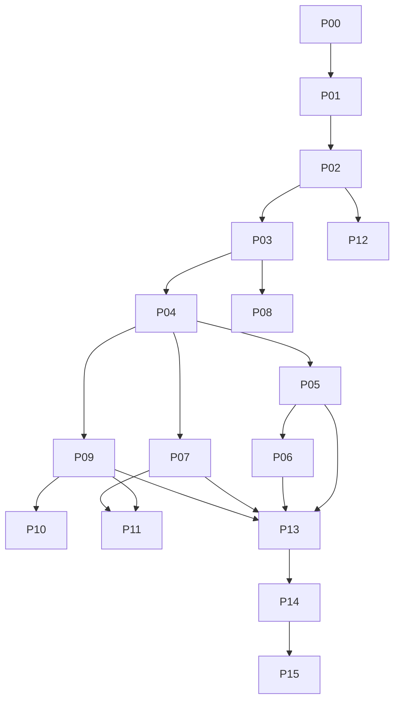

# Phases

> تحديث التنفيذ: وصف P00 والـMock في هذا الملف يوثق الأصول عند مراجعتها. السورس الحالي المتصل وحدود قبوله في [IMPLEMENTATION](IMPLEMENTATION.md) و[STATUS](STATUS.md). جدول المراحل هنا خطة قبول، مش إعلان اكتمال إنتاجي.

الترتيب حسب اعتماديات Nuqta الموجودة. كل الملفات والمسارات الجديدة تحت **مقترحة** لحد P01؛ `SA/MD/CA/CU/LC` تشير للمصادر الحالية في SCREEN-TO-FEATURE-MAP. تحويل الواجهة يحتفظ بالتصميم، والتعديل بيكون في السورس الجديد بدل تحرير export مضغوط. Task IDs والتفاصيل التنفيذية في [TASKS](TASKS.md)، Migrations في [DATABASE-PLAN](DATABASE-PLAN.md)، API IDs في [API-PLAN](API-PLAN.md).

`day` = يوم عمل لشخص هندسي، شامل مراجعة واختبارات المهمة. النطاقات تقدير أولي لشخص عنده خبرة، مع QA جزئي، ومن غير انتظار موافقات خارجية أو إعادة تصميم. مش مواعيد تسليم مضمونة ولا تكلفة مالية. أول دورة مسؤولة تقريبًا **39–66 person-days** بحسب Auth وجودة تحويل الواجهات؛ يتعاد التقدير بعد P01/P02. مراحل المزودين تتوسع حسب الحسابات والاعتمادات.

P10/P11/P12 تتطلب P13/P14 verification لو هتدخل الإطلاق. ممكن أول Pilot يكون web loyalty مع manual billing وبدون Wallet/marketing بعد تسجيل النطاق صراحة. مفيش phase مكتملة لو ميزاتها المفعلة مااجتازتش شروطها. الـobservability الأساسية موجودة في P01/P04؛ عزل وتزامن وتتبع كل ميزة مش مستنيين P09/P13.

## P00 — Repository audit and local run

| البند | التنفيذ والقبول |
|---|---|
|1 الهدف والنتيجة | نفهم الموجود ونشغّل الـDemo ونسلّم خطة مرتبطة بكوده. |
|2 Dependencies | الأصول الست والمجلد المحلي. |
|3 Tasks | P00-01،P00-02،P00-03. |
|4 الموجود اللي هننقله | قراءة standalone فقط؛الأصول من غير تعديل. |
|5 Modules وملفات جديدة | tools/serve-demo.cjs و tools/audit و docs/execution و root README. |
|6 Migrations | لا يوجد؛مفيش DB حاليًا. |
|7 API contracts | جرد NQ وعقود مستهدفة موثقة فقط. |
|8 ربط الشاشات | 6 صفحات و 18 view؛رحلات التسجيل والختم وفتح التفاصيل والـwizard. |
|9 الصلاحيات | متصفح اختبار مؤقت؛لا حسابات أوإرسال خارجي. |
|10 النجاح والفشل وإعادة المحاولة | server و Edge اشتغلوا معًا بعد تجاوز قيد بيئة sandbox بإذن الأداة؛القيود متوثقة. |
|11 Logging والمراقبة | JSON evidence و screenshots و body text و SHA256. |
|12 الاختبارات | 6 smoke checks؛34 successful checks و 9 defects reproduced؛syntax/docs checks. |
|13 Acceptance criteria | 13 ملف خطة مترابطين؛الموجود والـMock مفصولين؛كل finding بدليل. |
|14 تجربة المالك | يشغّل server ويفتح launcher ويجرّب lost response. |
|15 المخاطر والعوائق | لا Git أو source project قابل للبناء؛النسخة الحالية غير صالحة لبيانات حقيقية. |
|16 المجهود | 1–2 days تقديري؛التسليم ده اتنفذ في الجلسة الحالية. |
|17 التراجع والتعافي | إيقاف server؛الإضافات منفصلة عن الأصول؛لا بيانات تجارية اتغيّرت. |
|18 Definition of Done | فهرس وحالة وأدلة قابلة لإعادة التشغيل وخطة مراحل كاملة. |

## P01 — Foundations, database, auth, tenant isolation

| البند | التنفيذ والقبول |
|---|---|
|1 الهدف والنتيجة | تطبيق قابل للبناء وتسجيل دخول حقيقي مع عزل كل actor و tenant. |
|2 Dependencies | P00؛اختيار Auth adapter بلا شراء غير معتمد. |
|3 Tasks | P01-01 إلى P01-05. |
|4 الموجود اللي هننقله | tokens و LC والترجمات من exports؛NQ يبقى fixture للتطوير والاختبار. |
|5 Modules وملفات جديدة | apps/web و apps/api و apps/worker و packages/contracts/ui و db/migrations و CI و env template. |
|6 Migrations | M001 users/tenants/grants/audit و RLS roles؛seed لتاجرين. |
|7 API contracts | API01–03 و API40؛OpenAPI و typed errors و authorization context. |
|8 ربط الشاشات | login و MFA و recovery و session guard و shell للأربع واجهات. |
|9 الصلاحيات | PA/PS/MO/MM/CA/CU؛active grants ونطاق الفروع من الخادم. |
|10 النجاح والفشل وإعادة المحاولة | رفض expired/revoked sessions؛generic Auth responses و rate limits؛لا OTP ثابت. |
|11 Logging والمراقبة | requestId و structured logs من غير أسرار و readiness و DB scope counters. |
|12 الاختبارات | A/B API و SQL و pool context reset و CSRF و session revoke و fresh build. |
|13 Acceptance criteria | foreign tenant مرفوض حتى مع ID صحيح؛runtime role محدودة؛لا أسرار في client bundle. |
|14 تجربة المالك | يدخل كـA ويحاول URL/API لـB فيترفض؛logout يبطل session. |
|15 المخاطر والعوائق | تكلفة ومكان Auth و MFA/recovery؛local sink يتيح التقدم لحين القرار. |
|16 المجهود | 7–12 days؛من غير انتظار حسابات أو KYC. |
|17 التراجع والتعافي | previous compatible artifact و session revocation؛upgrade/restore لـM001 مجرّبين. |
|18 Definition of Done | CI و negative isolation tests ناجحين؛أوامر التشغيل الفعلية متوثقة. |

## P02 — Merchant provisioning, branding, branches, staff

| البند | التنفيذ والقبول |
|---|---|
|1 الهدف والنتيجة | موظف غير تقني يجهّز تاجر بهويته وفروعه ودعواته من UI. |
|2 Dependencies | P01 Auth و isolation و contracts. |
|3 Tasks | P02-01 إلى P02-05. |
|4 الموجود اللي هننقله | SA wizard/activation و MD brand/team/settings و LC preview. |
|5 Modules وملفات جديدة | provisioning step runner وbranding/assets وstaff/grants وmanual entitlements وdurable worker للدعوات. |
|6 Migrations | M002 brands/assets/branches/staff/invites/drafts/activations/steps/plans وoutbox/jobs base قبل أي إرسال خارجي. |
|7 API contracts | API04–12 و initial API14 و manual API38. |
|8 ربط الشاشات | wizard7steps و draft resume و activation status؛اختيار branch grants لكل موظف. |
|9 الصلاحيات | PA تجهيز؛MO فريق وهوية؛MM محدود؛منع self escalation وحذف آخر owner. |
|10 النجاح والفشل وإعادة المحاولة | activation مرتبطة بـdraft revision؛retry ترجع نفس resources؛فشل دعوة أو Wallet مستقل. |
|11 Logging والمراقبة | activationId و step/resource refs ومحاولات outbox وتنبيهات فشل الدعوات. |
|12 الاختبارات | double activation و timeout و unsafe upload و foreign asset و staff disable و quota races. |
|13 Acceptance criteria | تاجر بفرعين وكاشير لفرع واحد؛لا تكرار merchant/invite/asset؛web جاهز مستقلًا. |
|14 تجربة المالك | يحفظ draft ويرجع لها ويفعّل مرتين؛يشوف نفس التاجر ويوقف وصول كاشير. |
|15 المخاطر والعوائق | sender domain للدعوات الخارجية؛أسعار الـDemo غير معتمدة؛رفع الملفات يحتاج validation. |
|16 المجهود | 8–14 days مع تحويل تصميم الـwizard الموجود. |
|17 التراجع والتعافي | قبل التفعيل draft revision؛بعده suspend أو retry step؛لا حذف موارد لها نشاط. |
|18 Definition of Done | UI تجهيز شغالة؛التكرار والعزل مثبتين؛كل step لها status و owner و action. |

## P03 — Customer enrollment and branded web cards

| البند | التنفيذ والقبول |
|---|---|
|1 الهدف والنتيجة | العميل يسجل من QR ويحصل على كارت محفوظ ومستقل لكل تاجر وبرنامج. |
|2 Dependencies | P01 verified identity و P02 merchant/branch/program. |
|3 Tasks | P03-01 إلى P03-04. |
|4 الموجود اللي هننقله | CU landing/email/OTP/consent/card/help و LC و MD programs. |
|5 Modules وملفات جديدة | enrollment و tenant profiles و memberships و program versions و card repository و QR/token service. |
|6 Migrations | M003 profiles/memberships/terms/versions/presentation tokens. |
|7 API contracts | API13–17 و consent persistence subset من API34. |
|8 ربط الشاشات | join و recover واختيار برنامج و card list و card و QR؛Wallet غير الجاهز يتعطّل. |
|9 الصلاحيات | public branding فقط؛CU عضوياته؛التاجر tenant profile فقط. |
|10 النجاح والفشل وإعادة المحاولة | duplicate enroll ترجع الموجودة؛expired OTP/token مرفوض؛الشروط مطلوبة والتسويق اختياري. |
|11 Logging والمراقبة | enrollment errors وتحويل الرحلة بلا email raw؛terms version و token issuance audit. |
|12 الاختبارات | concurrent enrollment و multi-merchant independence و recovery abuse و QR roundtrip و forgery. |
|13 Acceptance criteria | reload وجهاز ثانٍ يرجعوا نفس العضوية؛scan URL لا يمنح ختمًا؛version محفوظة. |
|14 تجربة المالك | ينضم بنفس العميل لـA و B ثم يسترجع كروته بتحقق آمن ويرى أرصدة مستقلة. |
|15 المخاطر والعوائق | email delivery مؤهل قبل Pilot خارجي؛المراجع اليدوية لا تثبت شراءً تلقائيًا. |
|16 المجهود | 6–10 days؛المتصفح على الموبايل هو الأساس. |
|17 التراجع والتعافي | تعطيل التسجيل الجديد بـflag؛الكروت الحالية read-only عند العطل؛لا reset للعضويات. |
|18 Definition of Done | server-backed cards و verified enrollment و unique membership؛لا fixed OTP أو QRPAT. |

## P04 — Cashier scanning and atomic stamp engine

| البند | التنفيذ والقبول |
|---|---|
|1 الهدف والنتيجة | كاشير يمنح ختمًا أوأكثر بإيصال بأثر محفوظ مرة واحدة. |
|2 Dependencies | P01 authorization و P02 staff/branches و P03 membership/presentation. |
|3 Tasks | P04-01 إلى P04-05. |
|4 الموجود اللي هننقله | CA scanner/member/stamp/review/pending/receipt/error و CU balance و MD/SA minimal reporting. |
|5 Modules وملفات جديدة | loyalty commands و SQL repos و purchase canonicalizer و operation store و outbox worker و scanner adapter. |
|6 Migrations | M004 purchases/allocations/operations/idempotency/ledger/accounts/grants/outbox/jobs. |
|7 API contracts | API17–19 و minimal API26/29؛integer quantity و body hash. |
|8 ربط الشاشات | كاميرا حقيقية و manual fallback؛receipt review؛pending recovery بعد reload؛scoped tx list و trace lookup. |
|9 الصلاحيات | active staff/tenant/branch/program/quantity/entitlement؛authorization يسبق replay. |
|10 النجاح والفشل وإعادة المحاولة | success بعد commit؛lost reply يتحقق بنفس key؛أي method تستخدم نفس purchase key؛offline read-only. |
|11 Logging والمراقبة | operation/purchase/tx/audit/outbox refs؛lock waits و duplicates و ambiguity counters. |
|12 الاختبارات | 4+2→1+grant؛multiple thresholds؛2 DB connections؛same receipt؛kill بعد commit؛disable barrier. |
|13 Acceptance criteria | لا duplicate award أو partial commit أو foreign mutation؛3 stamps =purchase واحدة و visit واحدة. |
|14 تجربة المالك | يمنح 2 لرصيد 4/5 فيرى 1+grant؛يكرر نفس المحاولة ويقطع الرد من غير زيادة جديدة. |
|15 المخاطر والعوائق | تثبيت receipt scope لكل مصدر؛مرجع جديد متعمد يحتاج كشف احتيال؛كاميرا تحتاج أجهزة فعلية. |
|16 المجهود | 10–16 days تشمل concurrency harness و minimal reporting/tracing. |
|17 التراجع والتعافي | pause writes/worker عند اللزوم؛rollback متوافق؛reconcile من ledger؛لا حذف committed tx. |
|18 Definition of Done | invariants مثبتة تحت التزامن؛lost-response E2E ناجحة؛قواعد الولاء كلها على الخادم. |

## P05 — Rewards, redemption, expiration, corrections

| البند | التنفيذ والقبول |
|---|---|
|1 الهدف والنتيجة | صرف مكافأة مرة واحدة بشروطها المكتسبة وتصحيح الأخطاء بعمليات تعويضية متتبعة. |
|2 Dependencies | P04 grants/ledger و P03 version policy. |
|3 Tasks | P05-01 إلى P05-04. |
|4 الموجود اللي هننقله | CA redeemPick/redeemWait/correction و CU reward/holder dialog/history و MD correction approval. |
|5 Modules وملفات جديدة | redemption challenges و holder proof و expiry scheduler و compensation/review service. |
|6 Migrations | M005 challenges/redemptions/correction events و expiry indexes؛snapshots من M004. |
|7 API contracts | API20–23 و reward DTO؛expired/redeemed/needs_review errors. |
|8 ربط الشاشات | تأكيد منفصل من العميل و receipt للكاشير وتاريخ الصلاحية و manager review. |
|9 الصلاحيات | holder subject متحقق؛cashier active ومصرح للفرع؛قرار التصحيح من actor منفصل. |
|10 النجاح والفشل وإعادة المحاولة | lock grant وفحص expiry عند complete؛redemption واحدة؛التصحيح المتكرر نفس النتيجة؛unsafe reversal للمراجعة. |
|11 Logging والمراقبة | reward/challenge/redemption/correction/original tx refs و expiry lag و review queue. |
|12 الاختبارات | صرفان متزامنان و expiry بعد confirmation و wrong holder و version changes وتصحيح بعد نشاط لاحق. |
|13 Acceptance criteria | P05-04 تنجح في 12 خطوة؛F06/F07 مقفولين؛لا balance truncation أوضياع earned rights. |
|14 تجربة المالك | العميل يؤكد من جهازه؛كاشيران يصرفان فينجح واحد؛تصحيح غير آمن يروح review. |
|15 المخاطر والعوائق | تعويض reward مصروفة قرار مالك؛نسخ البرنامج pinned حسب D10؛لا عكس آلي مطلق. |
|16 المجهود | 8–14 days؛التصحيح الآلي بعد الدورة الداخلية وقبل Pilot. |
|17 التراجع والتعافي | تعطيل redeem/correction مع استمرار القراءة؛forward compensation بعد review؛لا مسح الحقوق. |
|18 Definition of Done | once-only redemption وشروط محفوظة واختبارات expiry/correction ودليل دورة المالك. |

## P06 — Customer requests and branch approval

| البند | التنفيذ والقبول |
|---|---|
|1 الهدف والنتيجة | العميل يطلب ختمًا من رابط الفرع؛الكاشير يطابق الكود ويراجع الشراء ويقرر. |
|2 Dependencies | P03 public links و P04 award/purchase key و P05 expiry patterns. |
|3 Tasks | P06-01 إلى P06-03. |
|4 الموجود اللي هننقله | CU request/reqStatus و CA queue/reqDetail/rejection sheet. |
|5 Modules وملفات جديدة | request state machine و matching validator و branch queue و reconnect sync. |
|6 Migrations | M006 requests/events و unique pending/final decision constraints. |
|7 API contracts | API24/25؛نفس purchase reference في A و B؛matching proof مطلوب. |
|8 ربط الشاشات | branch picker و code/countdown و approve/reject/cancel والنتيجة النهائية. |
|9 الصلاحيات | CU يملك العضوية؛CA active في الفرع؛الرابط العام لا يمنح أختامًا. |
|10 النجاح والفشل وإعادة المحاولة | approval/expiry/cancel يتنافسوا على transition واحدة؛retry بنفس key؛same purchase مرفوضة. |
|11 Logging والمراقبة | request→operation→purchase trace و approval latency و expired backlog. |
|12 الاختبارات | F08 و expiry أثناء انتظار lock و cancel مقابل approve و foreign branch و lost reply. |
|13 Acceptance criteria | طلب واحد لا ينتج أكثر من award واحدة؛العميل والكاشير يشوفوا نفس الحالة. |
|14 تجربة المالك | scan URL ثم request ثم matching و approve؛تكرار نفس الإيصال من scanner يترفض. |
|15 المخاطر والعوائق | كود المطابقة مش إثبات هوية بمفرده؛محاولاته محدودة؛مراجعة الإيصال مازالت بشرية. |
|16 المجهود | 4–7 days. |
|17 التراجع والتعافي | تعطيل طلبات جديدة؛القديمة تنتهي بوقتها؛لا requeue كشراء جديد. |
|18 Definition of Done | A/B يستخدموا نفس engine و uniqueness؛اختبارات transitions والصلاحيات ناجحة. |

## P07 — Merchant dashboards, segments, analytics

| البند | التنفيذ والقبول |
|---|---|
|1 الهدف والنتيجة | التاجر يفهم العملاء والفروع بمؤشرات واضحة قابلة للمطابقة مع السجل. |
|2 Dependencies | P04 purchase/ledger facts و P05 rewards و P06 لو requests مفعلة. |
|3 Tasks | P07-01 إلى P07-04. |
|4 الموجود اللي هننقله | MD overview/customers/details/branches/marketing و SA overview. |
|5 Modules وملفات جديدة | scoped read models و aggregation checkpoints و segments و private export worker. |
|6 Migrations | M007 aggregates/checkpoints/exports. |
|7 API contracts | API26/27 مع definition و window و timezone و watermark. |
|8 ربط الشاشات | dashboards/filters/directory/details/segments/export status/download. |
|9 الصلاحيات | MO tenant scope؛MM allowed branches؛export permission صريحة وإعادة تحقق عند download. |
|10 النجاح والفشل وإعادة المحاولة | rebuild آمن؛البيانات المتأخرة ظاهرة ب watermark؛export retry بنفس scope؛الموظف الموقوف مرفوض. |
|11 Logging والمراقبة | projection lag و reconciliation diff و export audit من غير raw PII. |
|12 الاختبارات | 3stamps=1visit؛customer متعدد البرامج؛day/branch boundaries؛return denominator؛export isolation. |
|13 Acceptance criteria | كل KPI لها formula/source/window/freshness؛الأعداد تطابق canonical facts؛never-active منفصلة. |
|14 تجربة المالك | عملية 3stamps تزيد الأختام 3 والزيارات 1؛المالك يفلتر فرعًا ويأخذ export مصرحًا. |
|15 المخاطر والعوائق | رجوع العميل بعد حملة مش إثبات سببية؛retention و PII policy محتاجين قرار مالك. |
|16 المجهود | 7–12 days. |
|17 التراجع والتعافي | إعادة بناء read models؛إيقاف exports وإلغاء روابطها؛لا كتابة في ledger. |
|18 Definition of Done | تعريفات المقاييس موثقة وتقارير مطابقة و export isolation مثبت. |

## P08 — QR/NFC materials and fulfillment

| البند | التنفيذ والقبول |
|---|---|
|1 الهدف والنتيجة | كل ستاند أواستيكر له QR ورابط مستقل قابل للإلغاء والاستبدال مع تاريخ تجهيز وتركيب. |
|2 Dependencies | P03 real QR/resolve و P02 branch/brand/assets. |
|3 Tasks | P08-01 إلى P08-03. |
|4 الموجود اللي هننقله | MD material center و SA wizard materials و CU landing. |
|5 Modules وملفات جديدة | placements و fulfillment و QR artifact generation و physical verification records. |
|6 Migrations | M008 placements/events/replacements/fulfillment/device checks. |
|7 API contracts | API13/28؛حالة revoked واضحة. |
|8 ربط الشاشات | download/copy و piece pipeline وتعليمات NFC و verify/revoke/replace. |
|9 الصلاحيات | MO طلب/إلغاء؛PA/Ops إنتاج وشحن؛CA تحقق مادي في فرعه. |
|10 النجاح والفشل وإعادة المحاولة | إلغاء قطعة لا يوقف الباقي؛replacement idempotent؛فتح رابط لا يمنح award. |
|11 Logging والمراقبة | placement/operator/device/time refs ومحاولات الروابط الملغية. |
|12 الاختبارات | encode/decode و quiet zone وطباعة و iOS/Android tap و revocation و duplicate orders. |
|13 Acceptance criteria | التاج يفتح الفرع الصحيح من جهاز ثانٍ؛QR بديل يعمل؛verify لها دليل فعلي. |
|14 تجربة المالك | يلغي قطعة ويجرب القديمة والبديلة ويعرف مَن اختبر التاج ومتى. |
|15 المخاطر والعوائق | هاردوير متوافق و budget قبل الشراء؛NFC URL مختلفة عن Wallet contactless. |
|16 المجهود | 4–7 days؛من غير تصنيع أوشحن أو شراء أجهزة. |
|17 التراجع والتعافي | إلغاء القطعة المتأثرة مع QR بديل؛حفظ التاريخ؛لا إيقاف روابط التاجر بالكامل. |
|18 Definition of Done | lifecycle متتبع و physical evidence لكل قطعة حالتها verified. |

## P09 — Platform operations, support, observability

| البند | التنفيذ والقبول |
|---|---|
|1 الهدف والنتيجة | فريق الدعم يلاقي العملية ويحدد سبب فشلها ويعيد المسموح بأمان. |
|2 Dependencies | P01 audit/roles و P04 traces/outbox وأحداث الميزات المفعلة. |
|3 Tasks | P09-01 إلى P09-03. |
|4 الموجود اللي هننقله | SA operations/support/integrations/system/settings و merchant tabs. |
|5 Modules وملفات جديدة | ops read models و job controls و support/reveal audit و alerts/runbook links. |
|6 Migrations | M009 tickets/messages/support access و job attempt details. |
|7 API contracts | API29–31 و API40. |
|8 ربط الشاشات | timeline بالـtx/receipt/attempt و job attempts و ticket thread و provider/cert metadata. |
|9 الصلاحيات | PS أقل صلاحية؛PA integration rotation مع MFA؛PII reveal بمبرر؛لا arbitrary SQL. |
|10 النجاح والفشل وإعادة المحاولة | retry يراجع lease/dedupe؛unknown paid result تتوقف للمراجعة؛dependency failure لها action. |
|11 Logging والمراقبة | latency/errors/locks/outbox age/cert days/unknown outcomes؛كل alert لها owner. |
|12 الاختبارات | job/cache/file/support scope و reveal بلا سبب و retry أثناء running و provider outage. |
|13 Acceptance criteria | transaction ID توصل للـledger/audit/outbox/provider attempt من غير كشف أسرار. |
|14 تجربة المالك | يدور على award فشل تحديث Wallet لها ويشوف إن balance محفوظ وسبب job failure. |
|15 المخاطر والعوائق | تحديد on-call وقناة التنبيه؛health تقيس التشغيل الفعلي بدل demo toggles. |
|16 المجهود | 5–9 days. |
|17 التراجع والتعافي | pause/throttle worker؛read-only عند الحاجة؛leases بف encing؛manual replay متتبع. |
|18 Definition of Done | failure injection ينتج alert وتشخيص وتعافي آمن مثبتين. |

## P10 — Wallet provider integrations

| البند | التنفيذ والقبول |
|---|---|
|1 الهدف والنتيجة | العميل يضيف pass حقيقية لدى المزود المؤهل ويشوف بياناتها تتحدث. |
|2 Dependencies | P03 cards و P04 outbox/revisions و P09 ops؛تفويض الحساب والعلامة D17. |
|3 Tasks | P10-01 إلى P10-04. |
|4 الموجود اللي هننقله | CU Wallet buttons و SA provider health/tasks و MD preview. |
|5 Modules وملفات جديدة | WalletAdapter و Apple signing/registration و Google class/object و reconciliation. |
|6 Migrations | M010 connections/capabilities/passes/registrations/secret references. |
|7 API contracts | API31–33 وبروتوكول كل provider الرسمي. |
|8 ربط الشاشات | جاهزية مستقلة لكل merchant/provider؛real add flow و remediation و cert rotation. |
|9 الصلاحيات | CU يملك pass؛PA integrations admin؛provider token منفصلة؛مفاتيح server-only. |
|10 النجاح والفشل وإعادة المحاولة | stable pass IDs و upsert/reconcile بعد timeout؛تجاهل revision أقدم؛web balance لايتعطل. |
|11 Logging والمراقبة | last synced revision و certificate expiry و provider outcomes؛لا tokens في logs. |
|12 الاختبارات | real device save/update/remove/readd و renewal و 429/outage و out-of-order و tenant mapping. |
|13 Acceptance criteria | pass مثبتة ومحدثة لكل provider enabled؛تفويض الإصدار موثق؛لا mock ready. |
|14 تجربة المالك | يضيف pass ويمنح stamp فيرى update؛يفصل provider وتفضل web card صحيحة. |
|15 المخاطر والعوائق | حساب/شهادة/brand rights/publishing review؛حساب المنصة مش تفويضًا تلقائيًا. |
|16 المجهود | 10–18 days للمزودين؛وقت انتظار الموافقات منفصل. |
|17 التراجع والتعافي | تعطيل issuance أو push مع web fallback؛حفظ IDs؛rotation حسب provider runbook. |
|18 Definition of Done | دليل capability لكل تاجر ومزود واختبار أجهزة وعزل فشل ودليل تجديد. |

## P11 — Consent, notifications, campaigns

| البند | التنفيذ والقبول |
|---|---|
|1 الهدف والنتيجة | رسائل بموافقة العميل وبميزانية،مع فصل قبول الرسالة عن وصولها. |
|2 Dependencies | P07 segments و P09 worker/ops و P03 consent؛قنوات مؤهلة. |
|3 Tasks | P11-01 إلى P11-04. |
|4 الموجود اللي هننقله | CU preferences و MD marketing/reports و SA delivery states. |
|5 Modules وملفات جديدة | consent/delivery/budget/campaign scheduler و channel adapters و Web Push worker. |
|6 Migrations | M011 consent events/intents/deliveries/audiences/budget reservations. |
|7 API contracts | API34–36 و API39؛verified callbacks. |
|8 ربط الشاشات | opt-in/out و reachable preview و cost quote و schedule/timezone و delivery reports. |
|9 الصلاحيات | CU تفضيلاته؛MO campaign permission و budget/entitlements؛worker يعيد فحص consent. |
|10 النجاح والفشل وإعادة المحاولة | opt-out قبل dispatch يمنع الإرسال؛unknown paid result تتعزل؛intent/cost لايتكرروا. |
|11 Logging والمراقبة | accepted/delivered/failed/suppressed/unknown و cost cap و callback/opt-out lag. |
|12 الاختبارات | withdrawal race و budget concurrency و duplicate callbacks و timezone و push revoke/outage. |
|13 Acceptance criteria | لا paid send بلا provider/cost/consent معتمدين؛Wallet data sync مستقل عن marketing. |
|14 تجربة المالك | يجهز حملة ثم عميل يسحبموافقته؛التقرير يعرض suppressed وتتم تسوية الميزانية. |
|15 المخاطر والعوائق | WABA/templates/sender/account access والأسعار؛لا ضمان لتنبيه معكل Wallet update. |
|16 المجهود | 9–16 days للقنوات الأولى؛يزيد بحسب المزودين والاعتمادات. |
|17 التراجع والتعافي | campaign kill switch و dispatch pause؛reconcile قبل تحرير الحجز أو retry. |
|18 Definition of Done | دليل إرسال ومنع ومصالحة unknown outcomes وتقارير حقيقية لكلقناة مفعلة. |

## P12 — Subscription billing and entitlements

| البند | التنفيذ والقبول |
|---|---|
|1 الهدف والنتيجة | اشتراك وفاتورة وتجديد واضحين وحدود الخطة مطبقة من الخادم. |
|2 Dependencies | P02 manual entitlements و P09 ops؛قواعد تجارية ومزود دفع مؤهل. |
|3 Tasks | P12-01 إلى P12-04. |
|4 الموجود اللي هننقله | SA billing و merchant subscription و MD subscription/checkout. |
|5 Modules وملفات جديدة | BillingAdapter و subscription state machine و webhook inbox/reconciler و entitlement policy. |
|6 Migrations | M012 plan versions/subscriptions/invoices/payments/inbox/billing events. |
|7 API contracts | API37–39 مع signature validation للـraw body. |
|8 ربط الشاشات | checkout pending/paid/failed وفواتير و renewal/grace و usage-aware plan change. |
|9 الصلاحيات | MO billing_manage و PA billing_admin و provider WH؛browser لا يثبت paid. |
|10 النجاح والفشل وإعادة المحاولة | inbox dedupe؛out-of-order reconciliation؛downgrade لايمسححقوقًا مكتسبة. |
|11 Logging والمراقبة | invoice/payment/event refs و signature failures و lag/dunning/sync mismatch. |
|12 الاختبارات | 100 duplicate events و reversed order و amount/currency mismatch و timeout after charge و quota races. |
|13 Acceptance criteria | paid لها دليل من provider؛retry لا يكرر charge أو entitlement؛grace واضحة. |
|14 تجربة المالك | يدفع sandbox ويكرر webhook فيشوف فاتورة واشتراك واحد؛يجرب downgrade فوق حد الفروع. |
|15 المخاطر والعوائق | البلد/الكيان/recurring/prices/tax/refunds؛لا live charge قبل عرض التكلفة والموافقة. |
|16 المجهود | 8–14 days؛من غير KYC وعقود وانتظار settlement. |
|17 التراجع والتعافي | pause checkout/charges؛حفظ inbox؛reconcile مع provider؛لا manual paid بدون صلاحية ودليل. |
|18 Definition of Done | billing state موثقة و server entitlements و webhooks آمنة وقواعد تجارية معتمدة. |

## P13 — Security hardening, recovery, performance

| البند | التنفيذ والقبول |
|---|---|
|1 الهدف والنتيجة | إثبات أمان الميزات المفعلة وقابليتها للاسترجاع والأداء المناسب. |
|2 Dependencies | coreP05/P07/P09 وكل featureenabled؛الأمان الأساسي كان مع كل ميزة من الأول. |
|3 Tasks | P13-01 إلى P13-04. |
|4 الموجود اللي هننقله | كل ported UI و APIs و DBroles و uploads/jobs/exports و infra. |
|5 Modules وملفات جديدة | security/load/recovery suites و threat model و backup restore و a11y matrix. |
|6 Migrations | M013 حسب قياس queries و retention؛لا indexes عشوائية. |
|7 API contracts | اختبار كل authorization/error/abuse/health contract؛لا business API جديدة. |
|8 ربط الشاشات | focus/labels/status announcements و session expiry و network recovery و error boundaries. |
|9 الصلاحيات | مراجعة tenant/branch/support/provider مستقلة و least-privilege secrets. |
|10 النجاح والفشل وإعادة المحاولة | restore معزول ومزودين متوقفين؛pending operations تتصالح؛RPO gap تتوثق. |
|11 Logging والمراقبة | SLO و DB locks و projection drift و backup freshness و cost alerts. |
|12 الاختبارات | TEST-PLAN matrix و load/PITR و keyboard/screen reader و RTL/LTR/mobile. |
|13 Acceptance criteria | لا critical/high مفتوح؛RPO≤15min/RTO≤4h مقاسين؛performance targets تحتحملموثق. |
|14 تجربة المالك | يجرب outage/restore table-top ويراجع purchase/reward proof بعدالتعافي. |
|15 المخاطر والعوائق | قدرات وتكلفة الاستضافة والنسخ الاحتياطي؛load assumptions لازم تتثبت قبل القياس. |
|16 المجهود | 8–14 days؛إصلاح findings الجديدة يتقدر على حسب أثرها. |
|17 التراجع والتعافي | flags/throttling/previous compatible artifact؛forward fix للـledger؛DR مع reconciliation. |
|18 Definition of Done | أدلة QA للأمان والتعافي والأداء والإتاحة مراجعة؛runbooks و owners واضحين. |

## P14 — Staging, physical devices, merchant pilot

| البند | التنفيذ والقبول |
|---|---|
|1 الهدف والنتيجة | تجار حقيقيين يجربوا نطاقًا محدودًا بأجهزةفعلية مع متابعة وتدريب. |
|2 Dependencies | P13 gates و P05 corrections و P07/P09؛كل provider enabled يجتازبوابته. |
|3 Tasks | P14-01 إلى P14-03. |
|4 الموجود اللي هننقله | release web/API/worker و infra و pilot tenant configuration. |
|5 Modules وملفات جديدة | deploy pipeline و device matrix و pilot checklist و support training/feedback log. |
|6 Migrations | تجربة release migration chain على staging؛لا schema منغير rehearsal. |
|7 API contracts | تثبيت OpenAPI version و upgrade compatibility smoke. |
|8 ربط الشاشات | الأربع personas والرحلات المفعلة على mobile؛كاميرا و NFC/Wallet لومتفعلين. |
|9 الصلاحيات | مستخدمين وأجهزة وحسابات تجار منفصلة؛support access محدود. |
|10 النجاح والفشل وإعادة المحاولة | disconnect أثناء commit و worker restart و provider outage مع تعافي من غير تكرار. |
|11 Logging والمراقبة | daily ledger/report reconciliation و pilot incidents/health/costs. |
|12 الاختبارات | 12step E2E و physical scanning/lighting/permissions و RTL/LTR و rollback rehearsal. |
|13 Acceptance criteria | 2–3 تجارمقترحين لمدة 7–14 يوم؛صفر balance drift غيرمفسر؛توقيع قبول المالك. |
|14 تجربة المالك | موظف غير تقني يجهز تاجر؛كاشير وعميل ينفذوا award/redeem منأجهزتهم. |
|15 المخاطر والعوائق | تحديد تجار Pilot والهاردوير والشروط و sender domain؛لا paid provider بلا اعتماد. |
|16 المجهود | 6–10 person-days +7–14 calendar-days مراقبة مقترحة. |
|17 التراجع والتعافي | وقف writes لتاجر محدد لو فيه خلل؛قراءة ودعم مستمرين؛reconcile قبلالاستئناف. |
|18 Definition of Done | blocking defects مقفولة؛pilot report وقبول نطاق الإطلاق والأدلة محفوظين. |

## P15 — Production launch and operating handover

| البند | التنفيذ والقبول |
|---|---|
|1 الهدف والنتيجة | إطلاق محكوم ودعم وتشغيل مفهومين بدون اعتماد على مطور لتجهيز كل تاجر. |
|2 Dependencies | P14 signoff وكل enabled feature DoD وميزانية ونطاق تجاري معتمدين. |
|3 Tasks | P15-01 إلى P15-03. |
|4 الموجود اللي هننقله | production release/config و public terms و operations runbooks. |
|5 Modules وملفات جديدة | release checklist و on-call/access handover و incident templates و postlaunch report. |
|6 Migrations | expand/contract مع backup validation؛نفس artifact المجرّبة. |
|7 API contracts | versioned contracts و verified webhooks و health alerts. |
|8 ربط الشاشات | لا demo badges/reset/persona switches في production؛support flows جاهزة. |
|9 الصلاحيات | production roles محدودة و MFA و named owners؛لا shared admin credentials. |
|10 النجاح والفشل وإعادة المحاولة | cohort rollout و feature flags؛خطأ تعدى الحد يوقف التوسع؛unknown outcomes تتصالح. |
|11 Logging والمراقبة | SLO/cost/billing/cert/backup alerts مع on-call review. |
|12 الاختبارات | postdeploy smoke و stabilization monitoring و operating handover table-top. |
|13 Acceptance criteria | owner go/no-go؛support ينفذ provisioning/lookup/retry؛لا P0/P1؛billing يطابق النطاق المعلن. |
|14 تجربة المالك | يضيف تاجر من UI ويراجع خطة وقدرات وفاتورة ويتتبّع support operation بدون SQL. |
|15 المخاطر والعوائق | أفراد on-call و approved costs والنصوص التجارية؛قدرة غير جاهزة لا تتسوق كميزة جاهزة. |
|16 المجهود | 3–5 person-days +7 أيام stabilization مقترحة. |
|17 التراجع والتعافي | pause onboarding/writes حسبالخلل؛previous compatible artifact؛حفظ ledger/inbox و DR عند الحاجة. |
|18 Definition of Done | handover مستلمة وقبول المالك وفترة استقرار وأدلة تشغيل و backlog محدثة. |
