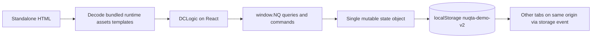

# Project audit

> تحديث التنفيذ: وصف P00 والـMock في هذا الملف يوثق الأصول عند مراجعتها. السورس الحالي المتصل وحدود قبوله في [IMPLEMENTATION](IMPLEMENTATION.md) و[STATUS](STATUS.md). جدول المراحل هنا خطة قبول، مش إعلان اكتمال إنتاجي.

**2026-11-07 — Africa/Cairo.** النتيجة: Nuqta Demo تفاعلية لها تصميم ورحلات مفيدة، لكنها **مش SaaS تجاري ولا أساس بيانات موثوق**. الموجود ست HTML exports؛ الكود المشترك بيشتغل بالكامل على جهاز العميل. مفيش backend أو database أو auth أوتكامل خارجي حي في التسليم الموجود.

## نطاق الفحص وحالة الملفات قبل الكتابة

مسار العمل الفعلي `F:\Nuqta Demo Build Complete`. قبل الإضافات كان فيه `standalone/` فقط و 6 ملفات HTML بإجمالي **4,830,086 bytes**. فحص `git status --short` من الجذر ومن `standalone` رجّع `fatal: not a git repository`؛ مفيش `.git` أو remote اتراجع، ولا نقدر ننسب محتوى لتاريخ commits. مفيش `AGENTS.md` في المجلد أو`F:\`، ولا README أو package.json أو lockfile أو env templates أو tests/config أوخطة سابقة. ده جرد المجلد المتاح، مش افتراض إن سورس المشروع مش موجود في مكان تاني على الجهاز.

الأصول الست اتسابوا من غير تعديل. [inventory.json](evidence/inventory.json) يسجل byte size و SHA256 لكل أصل ولكل embedded asset. `tools/audit/extract-demo.cjs` فَك gzip/base64 والـJSON template في مجلد evidence، وبيفشل لو نسخ الموارد المشتركة مختلفة. الملفات المستخرجة **دليل قراءة** مش ملفات production جديدة.

## Stack والإصدارات المثبتة بالدليل

| العنصر | الموجود فعلًا | الدليل |
|---|---|---|
| Packaging | standalone HTML bundler manifest،gzip/base64،DOMParser و Blob resources | كل أصل lines25–382؛ inventory لكل manifest |
| UI | React **18.3.1** + ReactDOM **18.3.1** UMD production داخل exports | manifest source URLs + resources inventory |
| Renderer | custom DC runtime،69,150 bytes،header يقول generated from `dc-runtime/src/*.ts` | [dc-runtime.js](evidence/extracted/dc-runtime.js) line1؛ مفيش package/version/source tree للـruntime |
| App logic | JavaScript،`class Component extends DCLogic`،`text/x-dc` templates،inline styles | `*.app.js` و`*.template.html` المستخرجة |
| Shared mock | NQ repository،54,591 bytes،نفس hash في الخمس exports التفاعلية | [mock-repository.js](evidence/extracted/mock-repository.js) |
| Storage/sync | Local Storage key `nuqta-demo-v2` + window storage event بين tabs | mock lines5,166–174 |
| Card | embedded `LoyaltyCard.dc.html`،classic/minimal/bold | [LoyaltyCard.dc.html](evidence/extracted/LoyaltyCard.dc.html) |
| Fonts | Geist،Geist Mono،IBM Plex Sans Arabic،WOFF2 مضمنة | template font-face + manifest MIME |
| Routing | أسماء HTML + query params + React local state؛ لا router package | componentDidMount و go/nav في app sources |
| أدوات الجهاز | Node **24.19.0**،npm **11.17.0**،Playwright **1.62.1** من runtime الجهاز | أوامر version و audit scripts؛ مش dependencies للمشروع |
| غير موجود | Vite/Next/Nest/Tailwind/PostgreSQL/Auth SDK/ORM/package manager config | الجرد وقت البداية؛ مينفعش نسبهم للـDemo |

محاولة `python --version` فشلت لأن WindowsApps alias غير قابل للتشغيل في sandbox؛ مفيش Python مطلوب للـDemo، واستخدمنا Node المتاح. ملفات HTML بتحتاج JavaScript ومتصفح يدعم DecompressionStream؛ assets مضمنة، وفحص فتح الصفحات لم ينتج requests خارج الـlocal origin. وجود روابط Google Fonts/React الأصلية في manifest مش معناه تحميلهم حي أثناء التشغيل.

## Routes والشاشات

الست صفحات: Demo Launcher،Design System،Super Admin،Merchant Dashboard،Cashier Portal،Customer Portal. كل واحدة ملف موجود باسم `Nuqta - <name>.html`، وممكن فتحها عن HTTP محلي. Super Admin فيه 9 top views و merchant detail بـ10 tabs و wizard7 خطوات. Merchant فيه 9 top views وتفاصيل عميل ومحرر برنامج وفرع و dialogs. Cashier عنده flow scanning/receipt/retry/request/redemption/correction. Customer عنده landing/email/OTP/consent/card/QR/rewards/requests/history/preferences/help. الخريطة الكاملة الحالية والمفقودة وعقود الربط في [SCREEN-TO-FEATURE-MAP](SCREEN-TO-FEATURE-MAP.md).

الموجود يصلح كمرجع UI و acceptance flows. login الحقيقي للموظف/admin والتاجر مش موجود، branch picker مصرح فعليًا مش موجود، export مش موجود، branch CRUD الكامل مش موجود، safe recovery للأوامر بعد إغلاق المتصفح مش موجود، history immutable للـprogram rules مش موجود.

## تدفق البيانات: mock مقابل الحقيقي

`seed()` ينشئ 5 تجار و 8 فروع و 9 staff منهم 2 platform،14 customers و 20 memberships و programs/rewards/transactions/jobs/invoices/campaigns جاهزة. البيانات والتوقيت نسبيين لـ`Date.now()`؛ مش سجلات تجارية. الأرصدة المزروعة والمكافآت والتاريخ مش ناتج replay واحد للـledger، فمينفعش يستخدموا لإثبات reconciliation.

`net()` مجرد setTimeout وبصّ على `session.network`. `lost` بيحفظ state ثم يرمي error؛ `checkAttempt()` يدوّر في array. `addStamps()` يجمع الرصيد ويكرر threshold ويصدر rewards، ويفحص receipt locally. `activateMerchant()` يولّد IDs عشوائية كل مرة، و`retryTask()` ينقل الحالة لـdone بعد انتظار. `chargeInvoice()` يبدّل invoice لـpaid من غير دفع. `createCampaign()` يولّد delivered/opened بأرقام حسابية. `setIntegration` ورفع certificate و logo محاكاة. camera UI عنده نص صريح إنه simulation، ومفيش `getUserMedia` أو scanner فعلي في app code. `QRPAT()` يرسم نقاط pseudorandom حول finder shapes؛ ده مش QR encoder، ولا يصلح proof لمسح مادي. presentation token `NQ.<membership>.<expiry>` من غير signature/secret.

الـOTP ثابت **123456** في source؛ أي شخص يختار customer/staff/merchant من query أو DevTools. كل بيانات التجار موجودة في مخزن واحد قابل للقراءة والتعديل. partial masking في الشاشة مش data minimization؛ full contacts موجودة في client state. `storage` sync مفيد للعرض على نفس المتصفح والـorigin، لكنه مش multi-device ولا transactional ولا قابل للتعافي كـDB.

## التشغيل والفحوص اللي اتنفذت

| الفحص | النتيجة الفعلية | الدليل وحدودها |
|---|---|---|
| Local HTTP server | شغال على 127.0.0.1؛الست صفحات 200 | `tools/serve-demo.cjs`؛server static فقط، no production backend |
| Browser smoke |6/6 صفحات rendered،zero page errors/failed requests | [browser-smoke.json](evidence/browser-smoke.json)،6 screenshots و body.txt |
| Main views |18/18 SA/MD top views اتفتحت | [browser-journeys.json](evidence/browser-journeys.json) IDs VIEW |
| UI stamp/lost reply/replay | نجح: balance4→0 وخروج grant،same-attempt replay مازودش tx؛customer tab اتحدث | UI:stamp-lost-response-replay-cross-tab + [screenshot](evidence/journey-stamp-replay.png)؛mock-only |
| UI enrollment | email→demoOTP→terms→card؛customer/membership persisted after reload | UI:customer-enrollment؛لا delivery أو verification حقيقي |
| UI details/editor/wizard | فتح customer detail و program editor و wizard7 step labels | UI:merchant-nested-screens،UI:provisioning-wizard؛مش تعبئة وتفعيل كل wizard steps E2E |
| Mock arithmetic |4+2/threshold5 →remaining1،grant1،replay بلا تكرار،same receipt across methods rejected | MOCK:arithmetic-replay-receipt؛داخل browser state واحد |
| Mock branch/disabled |رفض s_mai على b_zam و s_omar disabled | MOCK:branch-and-disabled؛فيه bypasses منفصلة تحت |
| Mock redemption/request |redemption second attempt rejected؛approve request غيّر status | MOCK:redeem-once،MOCK:request-approval؛مش security guarantee |
| Mobile smoke |8 snapshots،4 portals×ar/en على 390×844؛root scrollWidth390 في المسجل | LAYOUT IDs/screenshots؛مش تدقيق keyboard/screen reader أوكل nested screens |
| Final journey runner |**34 PASS +9 REPRODUCED findings،0 FAIL،0 page errors** | browser-journeys.json؛REPRODUCED دليل خلل مش نجاح إنتاجي |
| Syntax tools |`node --check` لأربع scripts نجح | server/extractor/browser runners؛لا يعادل lint/typecheck للتطبيق |
| npm lint/typecheck/build |**N/A**: مفيش package.json أو scripts أو source build | لم نخترع نتائج ولاقمنا install للـDemo |

أول محاولة Edge داخل sandbox فشلت في إنشاء profile، ثم server داخل sandbox ماكانش قابل للوصول من browser خارجه. تشغيل server+Edge معًا في process خارج sandbox في profile مؤقت نجح. ده عائق بيئة فحص، مش defect في HTML. أدوات الفحص مااستخدمتش profile المستخدم أو sign-ins. `browser-journeys-initial.json` محفوظ كأول تشغيل فيه 4 أخطاء selectors/timing في الـharness؛ اتصلحوا وانتهى الفحص النهائي بالنتيجة أعلاه. لا ننسب أخطاء الـselectors للمنتج.

## فجوات السلامة المُعاد إنتاجها

| Finding / درجة أثرها لو اتشحن الكود ده | Reproduction والنتيجة | المصدر / الحل المطلوب |
|---|---|---|
| F01 Critical tenant exposure | اختيار m_salon ثم قراءة c2 و ms_cafe_c2 رجّع بيانات m_cafe | Q.customer/membership و NQ.state؛P01 tenant auth + scoped DTO/RLS |
| F02 Critical authorization bypass | staff`s_nadia` owner في صالون يضيف stamp لكافيه؛ok=true | addStamps يفحص branch للـnon-owner بسولا staff.merchantId؛P01/P04 guards+FKs |
| F03 High fractional quantity |qty1.5 اتقبلت وغيّرت remaining لـ0.5 | qty range من غير integer check؛P04 schemas+DB integer |
| F04 High forged QR |`NQ.ms_cafe_c1` من غير expiry رجّع ok | resolveScan يقارن NaN؛P03/P04 opaque purpose-bound token |
| F05 High duplicate provisioning |activate نفس draft مرتين أنشأ merchant ين IDs مختلفة | activateMerchant؛P02 activation unique+step idempotency |
| F06 High repeated correction |قرار approve لنفس CR-12 مرتين أنشأ 2 corrections وغيّر balance مرتين | decideCorrection لا final guard؛P05 immutable compensation+unique |
| F07 High expiry bypass |reward تنتهي بعد holder confirm،completeRedemption نجح | no expiry recheck at completion؛P05 transactional reward lock |
| F08 High request race |2 approve متزامنين لنفس SR-301 بإيصالين سجّلوا 2tx | approveRequest يفحص status قبل await؛P06 request lock+state transition |
| F09 High replay/auth ordering |award ثم disable staff ثم replay نفس attempt رجّع ok/tx | dedupe قبل authorization؛P04 authorize replay +scope stored result |

الـfindings دي متوقعة من prototype، لكنها تمنع استخدامه التجاري. اتسجلت بدل ترقيع قواعد client وادعاء إنها أمان. عيوب إضافية من code review لم تُعاد إنتاجها كلها: corrections ممكن تتجاوز threshold من غير grant،program edits تستبدل row وتضيع history،wallet states ممكن تتبدل من العميل،localStorage save errors swallowed،invalid query IDs مشكلتها error boundaries ناقصة،لا CSRF/rate-limit/server-side permission،حملة«بكرة 10 الصبح» بتنتهي`Date.now()+D` بدل next local10:00،maxQty0 بيتحول 99 عبر`||`،receipt string لا يثبت شراء. تتغطى في backlog/tests.

## الأجزاء اللي نحافظ عليها والـRefactor

| نعيد استخدام | التعديل المطلوب / ليه |
|---|---|
| IA للأربع personas و 18sections وحالات pending/replay/decline | تحويل source components إلى React TS مع router و API commands؛الـexports مش buildable project |
| LoyaltyCard props و 3templates +merchant colors | UI package typed و tokens/CSS shared؛asset identity/version من server |
| Arabic/Englishcopy و Intl/RTL/bdi | نقل translation dictionaries ومراجعة مصطلحات ومقياس mobile/a11y؛تصحيح claims Wallet/visit قبل الإنتاج |
| receipt review +same attempt UI +lost response flow | الاحتفاظ بتجربة المستخدم وربطها DB operation snapshot؛durable pending key واسترجاع بعد reload |
| multi-program memberships و reward statuses | نقلها schema بقيود immutable versions و independent grants |
| operational timeline و safe retry UI skeleton | realjob attempts و redacted provider outcomes و lease-safe retries |
| NQservice seam و fixtures | dev/test adapter فقط؛لا استبدال net()بـfetch معترك business logic في browser |

التغييرات الحالية مضافةفقط: indexREADME،13 ملف خطة،أدوات فحص/static server،evidence مستخرجة وسجلات وصور. المجلد كان قابل للتشغيل كــHTML منغير build؛server مضافلتوحيد origin وتسهيل فتح الروابط،مش إصلاح ادعائي أوإضافة SaaS.
